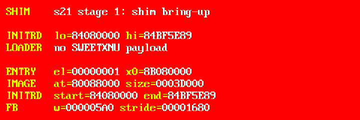

# s21xnu no S21 Ultra (p3s): contrato de hardware e perfil de painel

Rodadas de 25 e 26/11/2026 (Campo Grande). Análise estática das fontes e builds de
host. **Nada foi executado no aparelho; o bootloader continua informado como
travado.**

## Ponto de partida

O repositório público [jimmycarles9991-glitch/s21xnu](https://github.com/jimmycarles9991-glitch/s21xnu),
fixado em `a128f07b04987e60f5e13e2ce67b19ae009672cd`, é o port ios-sweet do
XNU `xnu-8796` (iOS 16) para o Galaxy S21+ SM-G996B (`t2s`), mesmo SoC Exynos
2100 do nosso SM-G998B (`p3s`). Segundo o README e as notas dele (não
reproduzido aqui), o kernel sobe nos oito núcleos, monta a raiz HFS+ por um
arquivo dentro de `userdata` com UFS somente leitura, tem touch e chegou à
tela de bloqueio/início com renderização por software em 31/10. O handoff
mais recente registra um panic precoce com a raiz completa de 16 GiB, então o
estado não é estável.

Caminho de carga dele: Linux 7.3.0-rc5 no próprio telefone (DTS
`exynos2100-t2s-firstlight-v32.dts`, não publicado) executa `kexec` do shim
(`shim/`, Image arm64) com o payload XNU como initrd. Isso exige bootloader
desbloqueado.

## Método

O verificador [`scripts/s21xnu_board_contract.py`](../scripts/s21xnu_board_contract.py)
compila com `dtc` a base `exynos2100.dts` e os overlays de placa do
FlopKernel (`dc17ad08a8b4f7fcabd3f949d9c83ff11c5f80ee`), mescla com
`fdtoverlay` e compara os recursos que o s21xnu fixa em código. Revisão
`r17` nas duas placas, porque o DTS HZC2 recebido tem `board_rev=0x11`
([registro](dts-source-roundtrip.md)). Hashes das fontes e dos FDT mesclados
estão no [relatório](references/s21xnu-board-contract-p3s-t2s-20261125.json).
Duas execuções produziram JSON idêntico.

```bash
python3 scripts/s21xnu_board_contract.py \
  --flop-dts FLOP/arch/arm64/boot/dts/exynos --json saida.json
```

O FDT base do FlopKernel não é o DTB stock HZC2 (398496 contra 389876
bytes). As placas foram comparadas entre si na mesma fonte; isso não substitui
o FDT final entregue pelo LK.

## Resultado: 21 itens iguais, 5 diferentes

| Recurso usado pelo s21xnu | p3s | t2s | Situação |
|---|---|---|---|
| Touch (0094): barramento, endereço, pinos | hsi2c@105D0000, 0x48, gpp4-0/1, ATTN gpa1-0 | igual | reaproveitável |
| Alimentação do touch (0094/0107) | S2DOS05 LDO2 tsp_io 1,8 V e LDO3 tsp_avdd 3,0 V | igual | reaproveitável |
| Coordenadas do touch | `sec,max_coords` 4096×4096 | igual | normalizadas, ver painel |
| Firmware do touch | `y792_p3.bin` | `y792_t2.bin` | mesma família slsi_ts; o s21xnu não grava firmware |
| PMIC S2DOS05 (0094) | hsi2c@10560000, 0x60, gpp0-2/3 | igual | reaproveitável |
| MAX77705 (0123) | hsi2c@10570000, 0x66, gpp1-0/1 | igual | reaproveitável |
| Teclas (0125) | gpa0-3/4, códigos 114/115 | igual | reaproveitável |
| GIC, Mali, UFS, MPIDR | 0x10200000/0x10240000, 0x18500000, 0x13100000, 0x000–0x700 | igual | reaproveitável |
| Reservas fixas na janela XNU 0x8c0000000–0x940000000 | nenhuma | nenhuma | janela utilizável nas duas placas |
| **Painel** | modos até **1440x3200** (S6E3HAD) | 1080x2400 (S6E3FAB) | **muda** |
| **Wi-Fi PCIe ch0** | `ep-ver` **0x4389**, Gen2 | 0x4375, Gen1 | **muda** |

As alimentações S2DOS05 também servem ao painel nas duas placas. O
power-cycle de LDO2/LDO3 que o s21xnu faz por padrão tem o mesmo risco nos
dois aparelhos.

### Painel

O LK HZC2 reserva `bootloader_fb` em `0xfa000000` com `0x1194000` bytes
([escritores condicionais](lk-dynamic-fdt.md)), exatamente 1440 × 3200 × 4.
Isso é coerente com scanout WQHD+ a 32 bpp, mas formato e stride vivos não
foram medidos. 1440x3200 é exatamente 4/3 de 1080x2400, com a mesma proporção
9:20.

A maior parte do XNU do s21xnu lê a geometria do ADT ou de `boot_args.Video`
(0003, 0046, 0112). Ficam fixos em 1080x2400:

| Local | Efeito no p3s |
|---|---|
| `shim/console.h`, `tools/mkadt.py` | geometria anunciada ao XNU, **corrigida pelo perfil abaixo** |
| 0010/0012/0106: depuração precoce com stride 4320 | marcas em posição errada; só diagnóstico |
| 0061: apresentação iPhone X 1125x2436 centrada em 1080x2400 | offsets ficam errados em 1440x3200 |
| 0094 linha 366, 0139: touch 0..4095 → 1080x2400 | no modo janela o toque sai a 3/4 da posição |
| 0058/0061: normalização HID por 1080/2400 | segue a mesma conversão |

### Wi-Fi

O BCM4389 do p3s é outro chip, com firmware, NVRAM e CLM próprios. O s21xnu
carrega BCM4375 (0109/0111/0142, `mkpayload.py --wifi-*`). No p3s, manter
`sweetpcie` no nível sem firmware até um port próprio.

## Perfil p3s para o s21xnu

[`lab/s21xnu-p3s/0001-board-p3s-framebuffer.patch`](../lab/s21xnu-p3s/0001-board-p3s-framebuffer.patch)
(compatível com `git apply` e `patch -p1` sobre `a128f07`) adiciona
`BOARD=` ao `shim/build-s21.sh` e `--board=` ao `tools/mkadt.py`:

| Perfil | FB_W × FB_H | Stride | Uso |
|---|---|---|---|
| `t2s` (padrão) | 1080 × 2400 | 4320 | S21+, byte a byte igual ao original |
| `p3s` | 1440 × 3200 | 5760 | painel inteiro; com os patches XNU 0146+0147, iPhone X 1125x2436 centrado com bordas |
| `p3s-window` | 1080 × 2400 | 5760 | janela no canto superior esquerdo; XNU sem mudança de geometria, toque desalinhado (3/4) sem ajuste em 0094 |

O [verificador](../lab/s21xnu-p3s/verify_p3s_profile.py) copia o clone
fixado, aplica o patch, compila o shim nos três perfis e gera o ADT com semente
fixa. 20/20 critérios: t2s idêntico ao original (shim `e91caec6…`, ADT
`4a4155f4…`), geometria do nó `sweet-fbcon` e dos macros que alimentam
`boot_args.Video`, base/tamanho do framebuffer preservados, padrão = t2s e
recusa de placa desconhecida
([resultado](references/s21xnu-p3s-profile-validation-20261125.json)). O XNU
não foi compilado; isso exige o runner macOS do workflow dele.

## Caminho de carga no p3s

O s21xnu depende de um Linux com `kexec` no telefone. Para o p3s há três
opções, todas após o desbloqueio OEM:

1. **Shim direto pelo S-Boot** (detalhado abaixo): shim como kernel e
   payload como ramdisk do `boot.img`, sem Linux. Cada teste é um flash via
   Odin.
2. **Kernel Android com `CONFIG_KEXEC`.** O `kernel.config` publicado pelo
   port MonsterROM (Floppy 5.4.304) tem `KEXEC` e `KEXEC_FILE` desligados.
   Um build próprio (o A0 já reproduz 5.4.242 com os 274 módulos) poderia
   ligar a opção e usar o Android rooteado como lançador.
3. **Linux mainline como no t2s.** Exige DTS p3s para Linux 7.x, que não
   existe publicado.

## Carga direta pelo S-Boot (26/11)

Contrato de entrada do shim (`a128f07`) contra o modelo do LK HZC2 já
documentado neste repositório:

| Exigência do shim | LK HZC2 (modelo estático) | Situação |
|---|---|---|
| Image arm64, código sem relocação absoluta (o build recusa ABS64) | copia para 0x80080000 + KASLR (0..0x1f8000, passo 0x8000) ([produtor](bootloader-hzc2.md)) | compatível; Image p3s 249.856 bytes |
| Entrada em EL1, MMU/caches desligados, x0 = FDT | X0 = 0x8b080000; helper desce EL2→EL1 ([granule](lk-entry-granule-hzc2.md), [cache](lk-cache-handoff.md)) | compatível no modelo |
| `/chosen` `linux,initrd-start/end` de 4 ou 8 bytes | LK grava células u32: 0x84080000 e +vendor+boot ([FDT dinâmico](lk-dynamic-fdt.md)) | compatível (`fdt_chosen_u64` aceita 4 bytes) |
| Procura SWEETXNU de 4 em 4 bytes desde initrd-start | ramdisk vendor em 0x84080000, ramdisk de boot logo após, **sem padding** ([cópias v3](lk-v3-layout.md)) | exige padding, ver abaixo |
| Header do payload alinhado a 8 (`copy64` em memória Device) | vendor ramdisk stock tem 12.017.257 bytes: o ramdisk de boot começa em **0x84bf5e69** | **7 bytes de padding** |
| PSCI por HVC | LK edita smc→hvc ([PSCI](lk-psci-final-edit-hzc2.md)) | coerente |

Sem o padding, o header fica em endereço ímpar. O shim não o acha, ou recusa
o header, e o XNU nunca recebe o controle. No caminho kexec do t2s o Linux
coloca o initrd alinhado a página, por isso o problema não aparece lá.

[`lab/s21xnu-p3s/mk_sboot_bootimg.py`](../lab/s21xnu-p3s/mk_sboot_bootimg.py)
monta o `boot.img` v3 a partir do `boot.img`/`vendor_boot.img` stock (mantém
os_version e cmdline do header), do `Image` do shim e do payload. O padding
sai do tamanho real do ramdisk vendor. O script recusa a montagem quando:
- o kernel com o maior KASLR alcança 0x84080000;
- o initrd passa do FDT do LK ou do staging 0x94000000;
- o ramdisk vendor contém SWEETXNU num endereço que o scan veria;
- a janela ou as escritas do payload (segmentos, ADT, boot_args) caem sobre
  o initrd, o FDT ou as reservas fixas do LK (uH, sboot, fb, kaslr, mz);
- a imagem excede a partição de 64 MiB.

Sem `--payload`, gera a **sonda**: o shim mostra `no SWEETXNU payload` em
vermelho, segue para o diagnóstico na tela (DTB, MMU, PSCI, GIC) e chama
PSCI SYSTEM_RESET após 40 s. A sonda não toca armazenamento: o teste UFS
do shim (`test_ufs`, só leitura) nem é chamado por `shim_main`. Como reinicia no mesmo
`boot.img`, sair do ciclo exige entrar no modo download e regravar o boot
stock.

### Execução no QEMU

[`lab/s21xnu-p3s/qemu/run_handoff.py`](../lab/s21xnu-p3s/qemu/run_handoff.py)
compila o shim `BOARD=p3s` e um kernel falso e monta o `boot.img` com um
ramdisk vendor sintético de 12.017.257 bytes. Depois reproduz o LK no QEMU
virt: Image em 0x80080000+KASLR, initrd vendor+boot em 0x84080000, FDT com
células u32 em 0x8b080000 e salto em EL1 com x0=FDT. O kernel falso imprime
`boot_args` na PL011.

Resultado: **57/57**
([JSON](references/s21xnu-sboot-handoff-qemu-20261126.json)).
- Nos KASLR 0, 0x8000 e 0x1f8000, o kernel falso recebeu o controle em EL1
  com Revision/Version 2, framebuffer 0xfa000000 1440×3200 stride 5760,
  ADT copiado e cmdline correta, e boot_args dentro da janela.
- O controle negativo, com o mesmo payload sem padding (header em
  0x84bf5e69, resto 1 mod 8), não chega ao kernel falso.
- Duas execuções deram o mesmo `boot.img` (SHA-256 `06f34148…`).

O QEMU virt não é o Exynos. O teste não cobre DECON/painel, uH, PSCI real,
UFS ou o FDT final do aparelho.

### Rodapé AVB de laboratório (26/11)

[`lab/s21xnu-p3s/avb_lab.py`](../lab/s21xnu-p3s/avb_lab.py) (usado por
`mk_sboot_bootimg.py --avb-lab-key PEM`) transplanta o vbmeta do boot.img
stock para o corpo novo. O resultado tem o mesmo formato que
`avbtool add_hash_footer` produz:
- vbmeta logo após o corpo alinhado a 4 KiB e rodapé AVBf no fim da
  partição de 64 MiB;
- `image_size` e digest do descritor `boot` recalculados;
- chave pública trocada pela de laboratório e assinatura RSA4096 refeita.

Usa o mesmo perfil canônico e as mesmas checagens de
`scripts/capture_a0_container.py`. O cabeçalho AVB do stock é preservado;
a extensão opaca Samsung do stock não vai para o corpo novo.

Seis controles com RSA real via openssl (`test_avb_lab.py`, no CI):
- hashes e assinatura válidos, com o vbmeta na posição esperada;
- saída determinística;
- adulteração quebra o hash;
- recusas: chave igual à do stock, corpo que não cabe, corpo que não é
  boot v3, assinatura curta ou de outra chave, stock inválido, stock fora do
  tamanho da partição.

Não houve conferência cruzada com o avbtool neste ambiente: o
android.googlesource.com está bloqueado aqui. O
`check_capture_a0_container.py` faz isso quando recebe o avbtool fixado.
Assinatura de laboratório não é confiança do aparelho.

### Sonda que fotografa o handoff (26/11)

[`lab/s21xnu-p3s/0002-probe-lk-handoff-facts.patch`](../lab/s21xnu-p3s/0002-probe-lk-handoff-facts.patch),
aplicado ao s21xnu depois do 0001, acrescenta quatro linhas à tela do
loader. A sonda as mantém por cerca de 25 s; uma foto da tela basta para
conferir o modelo do LK no aparelho.
[`qemu/probe_screenshot.py`](../lab/s21xnu-p3s/qemu/probe_screenshot.py)
carrega a sonda pelo handoff modelado (KASLR 0x8000), copia o framebuffer
pelo monitor do QEMU e grava o topo da tela
([PNG](references/s21xnu-sonda-qemu-20261126.png),
[JSON](references/s21xnu-sonda-qemu-20261126.json); idêntico em duas
execuções):



| Linha | Esperado no S21 Ultra (modelo) | Se vier diferente |
|---|---|---|
| tela vermelha com texto | DECON exibindo 0xfa000000 | nada na tela: o scanout do S-Boot não reflete escritas no framebuffer (`psr_mode=2`) |
| `ENTRY el=` | 1 | 2: o LK não desceu para EL1; o shim e o XNU esperam EL1 |
| `ENTRY x0=` | 8B080000 | outro endereço de FDT |
| `IMAGE at=` | 80080000 + KASLR (até 80278000, passo 8000) | dá o KASLR real ou mostra que o destino difere |
| `INITRD start=` | 84080000 | destino do ramdisk vendor diferente |
| `INITRD end=` | start + ramdisk vendor + ramdisk de boot (sonda: 84BF5E89) | ramdisk vendor de outro tamanho ou com padding: muda o padding do payload |
| `FB w= stride=` | 5A0 / 1680 (`BOARD=p3s`) | build com outro perfil |

### Alternar Android e s21xnu sem Odin (26/11)

O [DualbootHelper](https://github.com/justin-a30/DualbootHelper)
(`aec1ea2`) é o app do mod "Dualboot for any Samsung". Os scripts dele
(`res/raw/switch*.sh`) fazem três coisas:
- reparticionam o disco para criar cópias `_b`;
- trocam os nomes GPT de system, vendor, product, odm, efs, cache, userdata,
  super, prism e optics com `parted`;
- trocam o **conteúdo** de boot, recovery, dtb e dtbo com `dd`, porque o
  bootloader acha essas partições pelo nome fixo.

O vendor_boot não aparece nos scripts, e nada indica teste no S21 Ultra.

Para o s21xnu basta a parte do `dd` na BOOT. O shim usa o mesmo vendor_boot
stock e não precisa de sistema Android próprio.
[`lab/s21xnu-p3s/dualboot/s21xnu-switch.sh`](../lab/s21xnu-p3s/dualboot/s21xnu-switch.sh)
faz só isso, sem reparticionar e sem tocar em GPT, vendor_boot, recovery ou
vbmeta:
- **`install`:** copia a BOOT atual para `/cache/s21xnu/stock-boot.img`
  (CACHE tem 153.600 blocos de 4 KiB pela PIT, legível pelo TWRP) e grava
  `SHA256SUMS`;
- **`to-xnu` / `to-android`:** gravam com `dd`, conferem por SHA-256 relido
  da partição e reiniciam;
- recusa gravar o shim sobre uma BOOT de conteúdo desconhecido, mas sempre
  permite voltar ao stock; a volta depende só do backup stock e do hash dele
  (achado da revisão Codex no PR #104);
- a volta do XNU ou da sonda é pelo TWRP (Volume+ e Power):
  `sh /cache/s21xnu/s21xnu-switch.sh to-android`.

`test_s21xnu_switch.py`: 16 testes, com dash e bash, usando arquivos no
lugar da BOOT. Cobrem o ciclo completo, recusas de instalação, backup
corrompido, conteúdo desconhecido, comandos sem instalação e instalação a
partir do boot do shim. O script não foi executado em Android/toybox nem no
TWRP.

### Kit do primeiro boot (26/11)

[`lab/s21xnu-p3s/prepare_first_boot.py`](../lab/s21xnu-p3s/prepare_first_boot.py)
junta tudo num comando, para rodar no PC com o firmware do usuário:

    python3 lab/s21xnu-p3s/prepare_first_boot.py --stock-dir AP_HZC2/ \
        --s21xnu s21xnu/ --out kit-sonda/ [--lab-key lab.pem]

O que ele faz:
- confere `boot.img` e `vendor_boot.img`, crus ou `.lz4` como vêm no tar AP,
  contra os pins HZC2 de [capture-a0-pins](references/capture-a0-pins-hzc2.json),
  e recusa outro firmware;
- exige o s21xnu fixado e limpo, compila o shim `BOARD=p3s` com 0001+0002 e
  monta a sonda com rodapé AVB de laboratório (gera uma chave RSA4096 se não
  vier uma);
- entrega `boot.img` (64 MiB), `AP_s21xnu_sonda.tar` e `.tar.md5` para o
  Odin, `s21xnu-switch.sh`, `ROTEIRO.md` com os valores que a foto deve
  mostrar (INITRD end calculado do ramdisk vendor real), `relatorio.json` e
  `SHA256SUMS`.

`test_prepare_first_boot.py` tem 6 testes com RSA real e firmware sintético:
- conteúdo do kit e do tar do Odin, com o `.md5` anexado;
- kit reproduzível;
- recusa de firmware que não bate com os pins, cru e `.lz4`;
- saída que já existe;
- CLI sem firmware.

Uma execução completa com pins sintéticos compilou o shim do clone fixado.
O SHA-256 dele, `3a9f8039…`, é o mesmo do shim capturado no QEMU. O kit com
o firmware real depende dos arquivos do usuário, que não estão neste
ambiente.

### Antes de um teste no aparelho

- Desbloqueio OEM. O port MonsterROM, no mesmo HZC2 desbloqueado, grava o
  boot com rodapé AVB assinado por chave de teste (`avbtool add_hash_footer`,
  partição de 64 MiB, `SHA256_RSA4096`) e regrava o vbmeta
  (`recipes/package-r5-kernel-fix2.py`, `prepare-p3s-beta2.py` em
  `ba99fed`). Este repo não verificou como o LK desbloqueado trata um boot
  sem rodapé; os docs de AVB do LK cobrem o estado travado. Para reproduzir o
  formato do MonsterROM existe a opção `--avb-lab-key` (abaixo).
- O DECON 0 está em modo comando com disparo por hardware (`psr_mode=2`,
  `trig_mode=0`), igual no t2s, onde o framebuffer do S-Boot já é usado pelo
  s21xnu. Que escrever em 0xfa000000 apareça na tela do p3s continua não
  observado.
- Recuperação: TWRP com `s21xnu-switch.sh to-android` ou, sem TWRP, modo
  download e Odin com o boot stock.

## Toque e tela no p3s: patches XNU 0146 e 0147 (26/11)

Antes dos patches, o caminho de toque e tela fixava 1080x2400:
- o driver de toque (`bsd/dev/sweet_touch.c`) convertia o valor bruto
  0..4095 com `x*1080>>12`, `y*2400>>12`;
- o HID (`SweetHID.cpp`) limitava a 1079/2399 e normalizava com o crop do
  iPhone X calculado sobre 1080x2400;
- o `SweetFramebuffer.cpp` só apresentava o iPhone X 1125x2436 quando o
  painel era menor que ele. Num painel 1440x3200, passava a apresentar
  1440x3200 nativo, tamanho para o qual o UIKit não tem layout.

- [`0146-s21-touch-panel-geometry.patch`](../lab/s21xnu-p3s/xnu/0146-s21-touch-panel-geometry.patch):
  `ts_panel_map` escala pelo painel físico (boot-args `touch_panel_w`/`h`,
  padrão 1080/2400), espelha no painel e limita à vista do console
  (`PE_current_console`).
- [`0147-s21-p3s-letterbox-display.patch`](../lab/s21xnu-p3s/xnu/0147-s21-p3s-letterbox-display.patch):
  - o framebuffer também apresenta o iPhone X quando o painel é maior, centrado
    1:1 com bordas pretas (offsets negativos; o recorte das camadas e a
    limpeza de tela já tratavam isso);
  - o HID tira painel e offsets do console (`sweet_hid_geometry`), calcula as
    bordas de gesto pela parte visível (`sweet_hid_visible`) e limita a
    normalização a [0, 1].

| Perfil do shim | Console | Toque (boot-args) | Resultado |
|---|---|---|---|
| t2s (S21+) | 1080x2400 | nenhum | idêntico ao original |
| `p3s-window` | 1080x2400, stride 5760 | `touch_panel_w=1440 touch_panel_h=3200` | iPhone X recortado no canto superior esquerdo, toque alinhado |
| `p3s` | 1440x3200 | `touch_panel_w=1440 touch_panel_h=3200` | iPhone X inteiro centrado (157..1281 × 382..2817), bordas pretas |

[`verify_xnu_touch_patch.py`](../lab/s21xnu-p3s/xnu/verify_xnu_touch_patch.py)
reproduz o laço de patches do `build.sh` do darwin-xnu-build
(`663906528d1c`): `git apply --check` e aplica, ou pula, em ordem de nome.
Ele trabalha sobre o XNU `xnu-8796.141.3` (`1b191cb58250`). Depois aplica
0146 e 0147, extrai as funções puras e compila um teste de host. Resultado:
28/28 ([JSON](references/s21xnu-xnu-p3s-0146-0148-20261126.json), idêntico
em duas execuções):
- no S21+, toque, normalização HID e bordas de gesto ficam idênticos às
  fórmulas originais em todos os valores e pixels;
- no p3s tela cheia, cada pixel lógico do iPhone X volta ao mesmo valor
  normalizado pelo caminho tela → toque → HID;
- toques nas bordas pretas ficam limitados a 0/1.

Duas mutações deliberadas (limite da janela e borda visível com erro de um
pixel) fazem o verificador falhar. O XNU não foi compilado; isso exige o
runner macOS do s21xnu. Sem escala, no p3s o iPhone X ocupa 78% da largura.

### Escala para ocupar o painel: patch XNU 0148 (26/11)

[`0148-s21-p3s-scaled-display.patch`](../lab/s21xnu-p3s/xnu/0148-s21-p3s-scaled-display.patch),
sobre 0147, liga com o boot-arg `sweetfb_scale=1`:
- **o que muda na tela:** num painel maior que o iPhone X, ele é escalado à
  largura do painel (`sweet_present_fit`): 1440x3118 no S21 Ultra, com 41
  linhas de borda em cima e embaixo;
- **camadas BGRA:** são copiadas por vizinho mais próximo na CPU
  (`sweet_fb_scaled_blit`, recortado à superfície e ao tamanho do buffer).
  O blit da Mali só copia 1:1, então fica de fora nesse modo;
- **camadas YUV:** o retângulo de destino é convertido para o retângulo
  apresentado, e o laço existente já escala;
- **toque:** o HID usa o mesmo ajuste (`sweet_hid_fit`) e passa a medir a
  tela apresentada em pixels do painel (1440x3118, deslocamento -41);
- **sem efeito** no S21+ ou com `sweetfb_native=1`.

O verificador, agora 43/43, cobre 0146–0148 e passou idêntico em duas
execuções. Para o 0148 ele confere:
- o ajuste 1440x3118;
- o blit da tela inteira pixel a pixel contra o vizinho mais próximo, com
  as bordas intactas;
- o toque apontando o pixel lógico que o blit desenhou (±1);
- seis retângulos parciais, inclusive de 1 pixel em bordas fracionárias,
  cobrindo exatamente a amostragem inversa (limites com teto; achado da
  revisão Codex no PR #108, 800 pixels errados antes da correção);
- fonte curta sem leitura além do fim;
- retângulo vazio;
- S21+ e `sweetfb_native` inalterados.

Uma mutação (arredondar em vez de truncar na coluna) quebra 2.244.960
pixels e falha. O blit inteiro levou ~4 ms por quadro num Xeon de 2,1 GHz;
isso é só indicativo, o A78 não foi medido. O compositor já atualiza a tela
a 10 Hz por padrão (`sweetfb_hz`).

**Observação sobre a série do s21xnu.** O build pula silenciosamente todo
patch cujo `git apply --check` falha. Na reprodução sem os scripts `*.sh`
(não executados aqui porque alguns baixam código), 110 patches aplicam e 27
são pulados. Entre os pulados estão as variantes do Redmi (toque Goodix
0060/0063, USB 0072–0081, PCIe Qualcomm 0109–0112) e também
`0030-sweet-ufs-writes`, coerente com o UFS só leitura relatado pelo
s21xnu. Pulos que dependem de arquivos gerados por scripts (`sweet_hfs`)
podem não ocorrer no build real. A lista completa está no JSON.

## Coerências com este repositório

- PSCI por **HVC** observado pelo s21xnu bate com a
  [edição smc→hvc do LK](lk-psci-final-edit-hzc2.md).
- GICD/GICR, MPIDR e UFS conferem com [EXYNOS2100_HARDWARE.md](../EXYNOS2100_HARDWARE.md).
- O s21xnu usa o timer **virtual** (INTID 27). Nossa tabela registra o físico
  NS (INTID 30). Os dois PPIs existem; não é contradição.

## Correção paralela

`scripts/parse_fdt.py` (legado) tinha `FDT_PROP`/`FDT_END_NODE` trocados e lia
`off_mem_rsvmap` como versão: abortava em qualquer FDT real. Agora segue a
especificação e decodifica `reg` com as células do nó pai. Continua marcado
como leitor legado.

## Testes

`scripts/test_s21xnu_board_contract.py`: 11 testes com FDT sintéticos
(recusas de magic/truncamento/estrutura, células do pai, placas iguais,
diferenças estilo p3s, pinos de touch movidos, reserva invadindo a janela
XNU, recurso ausente, CLI/JSON e regressão do `parse_fdt.py`, que falha sem a
correção).

## Pendências

- Decisão sobre desbloqueio OEM: nenhuma opção de carga existe sem ela.
- Montar a sonda com o `boot.img`/`vendor_boot.img` stock reais (não estão
  neste ambiente) e conferir o relatório antes de qualquer flash.
- Patches 0146/0147 verificados na série; falta compilar no runner macOS do
  s21xnu. Ocupar o painel inteiro exigiria escalar no compositor (1,28×).
- Port BCM4389 ou Wi-Fi desligado.
- Conferir no aparelho o FDT final do LK e o scanout do `bootloader_fb`.
